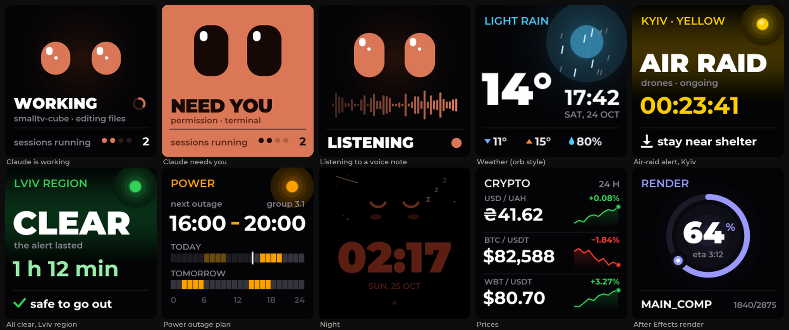
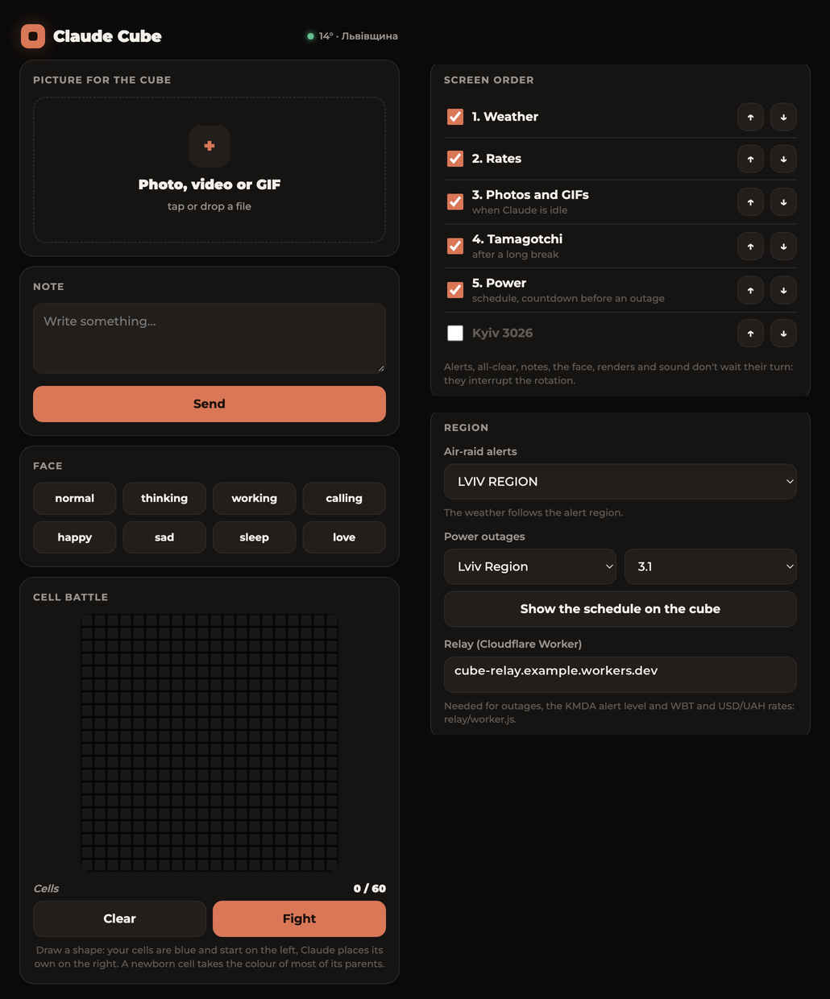

# Claude Cube

**English** · [Українська](README.uk.md)

Custom firmware that turns the **GeekMagic SmallTV-Ultra** (the little ESP8266 cube with a 240×240 screen) into a desk companion for [Claude Code](https://claude.com/claude-code). It shows Claude's face and what it is doing in your sessions, the weather with animated effects, air-raid alerts and power outages for any region of Ukraine, photos and GIFs, prices, render progress and a few games.

Languages: **Українська, English, Español**, switchable in the control panel.



<sub>Screens rendered from the design the firmware follows. On the cube the default weather is an animated illustrated sky; the orb style shown here is one setting away.</sub>



## What it shows

- **Claude's face.** Claude Code hooks send each session's state to the cube: thinking, working (with the tool and project), needs you (a question or a permission), done, failed. Several sessions at once are counted.
- **Listening.** While you dictate a voice message to the Claude desktop app, the cube shows the eyes and a live bar waveform with «СЛУХАЮ / LISTENING / ESCUCHO» (macOS, optional).
- **Weather.** An illustrated sky for the current conditions, with effects over the whole screen: rain splashes and drops on the glass, snow settling on the digits, storm shake, fog, sun glint (Open-Meteo, no key).
- **Air-raid alerts for your region.** Any oblast of Ukraine or Kyiv city, picked in the panel, with the real start time and a running timer, at full brightness, and a short all-clear screen afterwards. In Kyiv it also follows the KMDA level: yellow = drones, red = missiles or a massive attack. After 20 minutes the alert shows for 15 s every 3 minutes and lets the other screens run. The weather follows the region you pick.
- **Photos and GIFs** you upload from the control panel, shown only while Claude and renders are idle. The panel crops photos and turns videos into GIFs right in the browser.
- **Prices**: any Binance pairs, plus USD/UAH (NBU) and WBT/USDT through the relay.
- **Power outages for your region and group** (schedules aggregated by [svitlo.live](https://github.com/chaichuk/svitlo_live), most oblasts): the power screen shows today and tomorrow as 24-hour bars and the next outage; in the last 30 minutes it turns into a countdown, then «SAVE PROJECT».
- **After Effects renders**: `tools/aerender_cube.py` wraps `aerender` and shows a progress ring and a queue.
- **Night mode**: dim clock with a sleeping face, stars and the odd shooting star.
- **Extras**: a pet that gets hungry while you're away from the Mac, a «sit up straight» face every 30 minutes, a sound visualizer, notes from the panel, and «Cell battle», a two-colour Game of Life you play against Claude.

## Hardware

GeekMagic **SmallTV-Ultra** (ESP8266, ST7789 240×240, 4 MB flash). Other GeekMagic models have different pins and are not supported.

## Install

> Flashing custom firmware is at your own risk. Write down your stock firmware version first; GeekMagic publishes stock images if you want to go back.

1. **First flash.** Open the cube's stock web page, go to its firmware update page and upload `release/claude-cube-loader.bin.gz`. When the cube comes back as the loader, open `http://<cube-ip>/update` and upload `release/claude-cube.bin.gz`. (The full image is too big to update over itself, so a tiny loader always goes first; `tools/flash.sh` does both steps for you.)
2. **Wi-Fi.** On first boot the cube opens a hotspot called **ClaudeCube**. Join it and open `http://192.168.4.1`, then pick your 2.4 GHz network.
3. **Control panel.** Open `http://claudecube.local/` (or the cube's IP). Set the language, brightness, night hours, screen order and price pairs there.

### Claude Code on your Mac

```bash
tools/install_mac.sh claudecube.local
```

This adds the hooks to `~/.claude/settings.json` (a backup is kept), and installs a small background agent (`tools/cube_agent.py`, launchd) that delivers each session's state to the cube with retries, tells the cube when you're at the Mac, and follows the cube's IP and language. Hooks never call the cube directly, so bursts from many sessions are never lost.

Optional: `tools/senses/build.sh` builds **CubeSenses.app**, which watches for the Claude app recording a voice message and streams the microphone level to the cube only then. macOS asks once for microphone access.

### Relay (optional)

Some sources are HTTPS-only and too heavy for the ESP8266. `relay/worker.js` is a Cloudflare Worker that fetches them and answers in plain text: the KMDA alert level, WBT/USDT and USD/UAH, and power outage windows.

```bash
cd relay && npx wrangler deploy
```

Then enter its host (`<your-worker>.workers.dev`) in the panel under **Region**: the outage region and group lists come from it. Without a relay, alerts and weather still work.

## Build from source

PlatformIO (`pip install platformio`), then:

```bash
cd firmware && pio run -e ultra        # build
tools/flash.sh                         # flash over Wi-Fi (loader, then the build)
```

- Words on the cube and in the panel live in `tools/strings.py`. After editing run `python3 tools/gen_lang.py` (checks that every string fits), `python3 tools/make_fonts.py` if you added letters (needs Montserrat in `~/Library/Fonts`), and `python3 panel/build_page.py --gz --out firmware/src/webpage.h` for the panel.
- GIFs must be encoded with a 10-bit LZW dictionary to fit the decoder in RAM: use `tools/cube_gif.py` or the panel, which mark them `CUBE10`.
- Memory is tight (about 25 KB of heap without sprites): one 15 KB arena is shared by the weather sprite, the face sprite, the GIF decoder and the Life grids.

## HTTP API

| Endpoint | What it does |
|---|---|
| `/face?e=<emotion>&t=<label>&hold=<s>` | show a face: `idle thinking working attention happy sad sleepy love hello judge listen…`; with `sid=` it is a session state |
| `/render?p=<0-100>&eta=<s>&name=&f=&n=&q=&qn=&next=` | render progress; `state=done` or `state=fail` ends it |
| `/note` (POST `t=`, `sec=`) | a note on the screen |
| `/presence?idle=<s>` | the computer is on, idle for N seconds |
| `/life?side=1&cells=<400 × 0/1>` | place a shape in Cell battle |
| `/set?...` | settings: `brt nbrt non noff slide wxsec cxsec pairs order lang areg relay outr outg lat lon rot bgr`; `screen=outage` opens the power plan |
| `/status` | JSON: firmware, memory, screen, config, alert, weather |
| `/update` | firmware upload |

## Credits

Built with Claude. Uses [TFT_eSPI](https://github.com/Bodmer/TFT_eSPI), [TJpg_Decoder](https://github.com/Bodmer/TJpg_Decoder), [ArduinoJson](https://arduinojson.org), [U8g2_for_TFT_eSPI](https://github.com/Bodmer/U8g2_for_TFT_eSPI), a patched copy of Larry Bank's [AnimatedGIF](https://github.com/bitbank2/AnimatedGIF) (Apache 2.0, see `firmware/lib/AnimatedGIF`), the Montserrat font (SIL OFL), Open-Meteo, the ubilling.net.ua alert feed and KMDA's Telegram channel.
