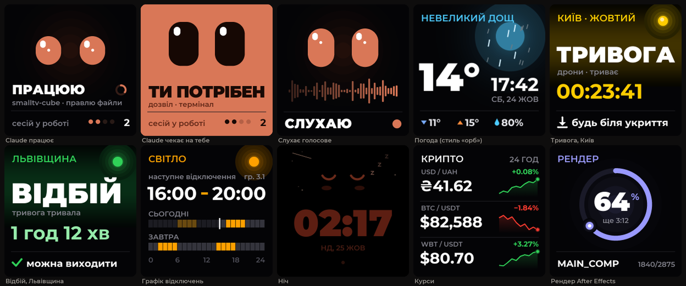
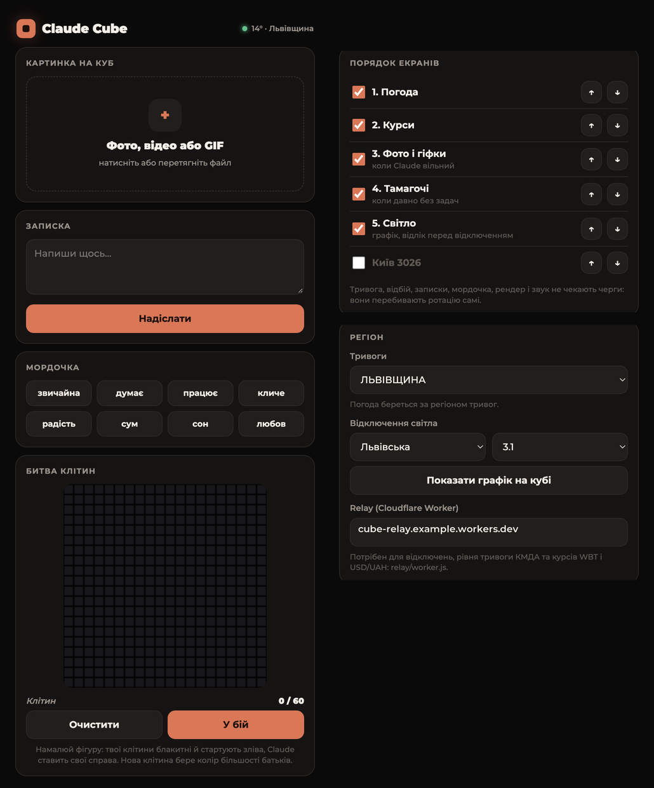

# Claude Cube

[English](README.md) · **Українська**

Власна прошивка, яка перетворює **GeekMagic SmallTV-Ultra** (маленький куб на ESP8266 з екраном 240×240) на настільного компаньйона для [Claude Code](https://claude.com/claude-code). Куб показує мордочку Claude і що він зараз робить у твоїх сесіях, погоду з анімованими ефектами, повітряні тривоги та графіки відключень світла для твого регіону, фото й гіфки, курси, прогрес рендеру і кілька ігор.

Мови: **українська, English, español**, перемикаються в панелі керування.



<sub>Екрани відмальовані з дизайну, за яким зроблена прошивка. На кубі за замовчуванням погода — анімоване небо; стиль «орб» на картинці вмикається в налаштуваннях.</sub>



## Для України

### Повітряна тривога

- **Регіон** обирається в панелі: «Налаштування → Регіон → Тривоги». Є всі області та окремо місто Київ. Погода підлаштовується під цей регіон.
- Дані — з публічної мапи тривог ([ubilling.net.ua/aerialalerts](http://ubilling.net.ua/aerialalerts/)), куб опитує її кожні 20 секунд напряму, без проміжних серверів. Таймер рахує від справжнього початку тривоги, навіть якщо куб увімкнули посеред неї.
- **Київ:** куб розрізняє рівні КМДА — **жовтий** (лише дрони) і **червоний** (ракети або масована атака) — так само, як «Київ Цифровий». Рівень береться з Telegram-каналу КМДА через relay (див. нижче).
- Під час тривоги екран горить на повну яскравість навіть уночі. Після 20 хвилин тривога показується 15 секунд кожні 3 хвилини, щоб куб не «зависав» на одному екрані. Після відбою — хвилина зеленого екрана «ВІДБІЙ» із тривалістю.
- Тривога головніша за все, крім екрана «СЛУХАЮ», поки ти диктуєш голосове.

### Відключення світла

- Екран **«Світло»** показує графік на сьогодні й завтра двома смугами по 24 години (кожен блок — пів години) і найближче відключення. За 30 хвилин до нього — зворотний відлік, за 5 хвилин — помаранчевий екран «ЗБЕРЕЖИ ПРОЄКТ».
- Графіки бере агрегатор [svitlo.live](https://github.com/chaichuk/svitlo_live): більшість областей, Київ, Дніпро (ДнЕМ і ЦЕК). У панелі: «Регіон → Відключення світла» — обери область і свою чергу (групу).
- **Як дізнатися свою чергу:** на сайті свого обленерго за адресою: у Києві — [ДТЕК Київські електромережі](https://www.dtek-kem.com.ua/ua/shutdowns), на Київщині — [ДТЕК Київські регіональні](https://www.dtek-krem.com.ua/ua/shutdowns), в Одесі — [ДТЕК Одеські](https://www.dtek-oem.com.ua/ua/shutdowns), у Дніпрі — [ДТЕК Дніпровські](https://www.dtek-dnem.com.ua/ua/shutdowns), в інших областях — на сайті місцевого обленерго або в застосунку «Світло». Черга виглядає як `3.1` (підчерги `.1` і `.2`), у Чернівецькій області — просто число.
- Кнопка «Показати графік на кубі» відкриває екран одразу.

### Курси

USD/UAH за курсом НБУ, WBT/USDT з WhiteBIT і будь-які пари Binance (наприклад `BTCUSDT`). Список задається в панелі.

### Relay

Частина джерел (рівень тривоги КМДА, курси НБУ і WhiteBIT, графіки відключень) працює лише через HTTPS, а ESP8266 на це не вистачає пам'яті. `relay/worker.js` — це безкоштовний Cloudflare Worker, який забирає ці дані й віддає кубу простим текстом:

```bash
cd relay && npx wrangler deploy
```

Адресу воркера (`<назва>.workers.dev`) впиши в панелі в «Регіон → Relay». Без relay тривоги й погода працюють, а відключень, рівня КМДА і курсів НБУ/WBT не буде.

## Що ще вміє

- **Мордочка Claude.** Хуки Claude Code надсилають кубу стан кожної сесії: думає, працює (з інструментом і проєктом), чекає на тебе (питання або дозвіл), готово, не вийшло. Кілька сесій рахуються разом.
- **«СЛУХАЮ».** Поки диктуєш голосове в застосунку Claude, куб показує очі й живу хвилю голосу (macOS, за бажанням).
- **Погода** з ефектами на весь екран: краплі на склі, сніг, що налипає на цифри, тремтіння в грозу, туман (Open-Meteo, без ключа).
- **Фото й гіфки** з панелі — тільки коли Claude і рендер вільні. Панель обрізає фото і робить гіфки з відео прямо в браузері.
- **Рендери After Effects:** `tools/aerender_cube.py` запускає `aerender` і показує кільце прогресу та чергу.
- **Ніч:** тьмяний годинник, сплюча мордочка, зорі й зрідка падаюча зірка.
- **Дрібниці:** тамагочі, що голодніє, поки тебе немає за Маком, «СЯДЬ РІВНО» кожні 30 хвилин, візуалізатор звуку, записки з панелі та «Битва клітин» — гра «Життя» на двох, де ти граєш проти Claude.

## Залізо

GeekMagic **SmallTV-Ultra** (ESP8266, ST7789 240×240, 4 МБ флешу). Інші моделі GeekMagic мають інші піни й не підтримуються.

## Встановлення

> Прошивка на власний ризик. Спершу запиши версію заводської прошивки; GeekMagic публікує заводські образи, якщо захочеш повернутися.

1. **Перша прошивка.** Відкрий заводську веб-сторінку куба, розділ оновлення прошивки, і завантаж `release/claude-cube-loader.bin.gz`. Коли куб перезавантажиться як loader, відкрий `http://<ip-куба>/update` і завантаж `release/claude-cube.bin.gz`. (Повний образ завеликий, щоб оновлюватися поверх себе, тому спочатку завжди йде маленький loader; `tools/flash.sh` робить обидва кроки сам.)
2. **Wi-Fi.** Під час першого запуску куб відкриває мережу **ClaudeCube**. Підключись до неї, відкрий `http://192.168.4.1` і обери свою мережу 2,4 ГГц.
3. **Панель керування:** `http://claudecube.local/` (або IP куба). Там мова, регіон, яскравість, нічні години, порядок екранів і курси.

### Claude Code на Маку

```bash
tools/install_mac.sh claudecube.local
```

Скрипт додає хуки в `~/.claude/settings.json` (з резервною копією) і ставить фонового агента (`tools/cube_agent.py`, launchd): він доставляє кубу стан кожної сесії з повторами, повідомляє, що ти за Маком, і стежить за IP та мовою куба. Підписи на кубі («правлю файли», «шукаю в коді») будуть мовою куба.

За бажанням: `tools/senses/build.sh` збирає **CubeSenses.app** — він помічає, коли застосунок Claude записує голосове, і лише тоді передає кубу рівень мікрофона. macOS один раз спитає дозвіл на мікрофон.

## Збірка з коду

PlatformIO (`pip install platformio`), далі:

```bash
cd firmware && pio run -e ultra        # збірка
tools/flash.sh                         # прошивка по Wi-Fi (loader, потім збірка)
```

Усі слова на кубі й у панелі — в `tools/strings.py`. Після змін: `python3 tools/gen_lang.py` (перевіряє, що кожен рядок влазить на екран), `python3 tools/make_fonts.py`, якщо додалися нові літери, і `python3 panel/build_page.py --gz --out firmware/src/webpage.h` для панелі. API куба описане в [англійському README](README.md#http-api).

## Подяки

Зроблено з Claude. Використано [TFT_eSPI](https://github.com/Bodmer/TFT_eSPI), [TJpg_Decoder](https://github.com/Bodmer/TJpg_Decoder), [ArduinoJson](https://arduinojson.org), [U8g2_for_TFT_eSPI](https://github.com/Bodmer/U8g2_for_TFT_eSPI), змінену копію [AnimatedGIF](https://github.com/bitbank2/AnimatedGIF) Ларрі Бенка (Apache 2.0), шрифт Montserrat (SIL OFL), Open-Meteo, мапу тривог ubilling.net.ua, Telegram-канал КМДА та графіки [svitlo.live](https://github.com/chaichuk/svitlo_live).
